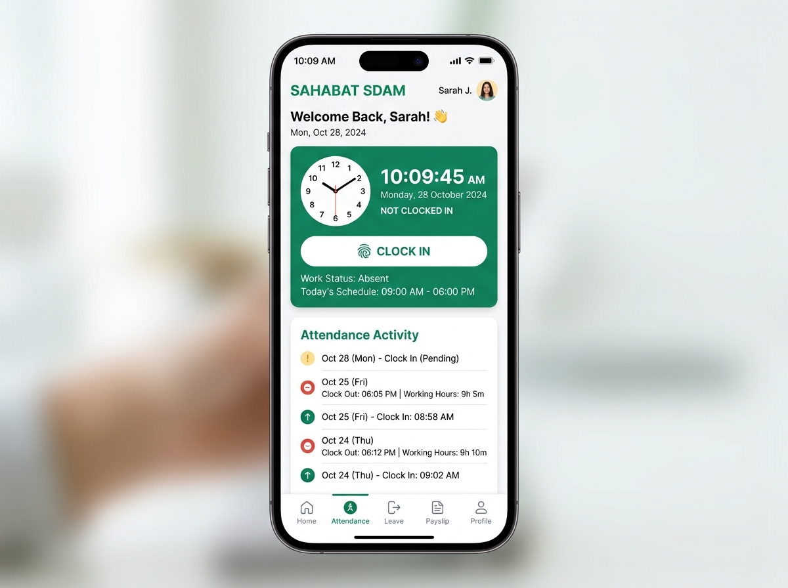

# SAHABAT SDAM (Habbits App)

Aplikasi manajemen habit, presensi pegawai, administrasi sekolah, persuratan, komunikasi internal, dan POS koperasi berbasis web (PWA) dan JSON API. Dibangun dengan Laravel 13, Inertia.js, dan Vue 3.

## ✨ Fitur Utama

- **Pelacakan Habit & Ibadah**: Pengisian form habit harian, voucher reward habit, rekap Qur'an & Hadis, dzikir, arah kiblat, HPT, kajian, serta catatan haid.
- **Presensi & Kepegawaian (HR)**: Check-in/check-out berbasis geolokasi & foto selfie, pengajuan izin/cuti, Kiosk RFID, integrasi push mesin fingerprint (`/api/fingerprint/sync`), jadwal piket/jam kerja, e-filing arsip pegawai, penilaian kinerja (KPI), jurnal harian guru, dan perangkat pembelajaran (administrasi guru + arsip tahun ajaran).
- **Tata Usaha & Persuratan**: Pengelolaan surat masuk, surat keluar (HTML builder + PDF + QR verifikasi publik), disposisi, serta notulen rapat dengan tanda tangan digital dan verifikasi publik.
- **Koperasi Sekolah (POS)**: Kasir POS (tunai, QRIS, saldo kartu RFID, voucher habit, split payment, dan bon), manajemen member & top-up saldo, stok opname, serta laporan laba/rugi dan ekspor Excel.
- **Komunikasi & Sistem**: Chat internal pegawai (direct, grup, dan channel divisi), real-time event via Laravel Reverb, Web Push Notification (VAPID), multi-account switching, audit login log, dan mode maintenance dengan simulasi role.

## 📸 Tampilan Aplikasi

| Tampilan Desktop (Dashboard) | Tampilan Mobile (Presensi PWA) |
| :---: | :---: |
|  |  |

> *Catatan: Gambar di atas menggunakan mockup pratinjau yang tersedia di repositori (`public/mockup.jpg` & `public/mockup2.jpg`).*

## 📋 Menu & Fungsi Aplikasi

Struktur menu disesuaikan otomatis berdasarkan role pengguna (`user`/Pegawai, `tata_usaha`, `koperasi`, `kurikulum`, `kepala_sekolah`, `admin`, dan `superadmin`) serta feature flag di pengaturan sistem:

### 1. Menu Pegawai (`user` & Semua Role)
- **Dashboard**: Ringkasan progres habit harian, status presensi hari ini, statistik capaian, dan notifikasi.
- **Presensiku** (`/presensi`): Check-in/check-out berbasis geolokasi (Leaflet) & foto selfie, pengajuan izin/cuti beserta lampiran, serta pembaruan keterangan terlambat.
- **Input Habit Harian** (`/habit/form`): Pencatatan amalan/kebiasaan harian beserta target pribadi.
- **Ibadah & Keislaman**:
  - **Al-Qur'an & Hadis** (`/quran-hadis`): Pelacakan sesi bacaan Al-Qur'an dan hadis harian.
  - **Dzikir Pagi & Petang** (`/dzikir`): Panduan dzikir harian.
  - **HPT Online** (`/hpt`): Akses materi Himpunan Putusan Tarjih.
  - **Arah Kiblat** (`/qiblat`): Penunjuk arah kiblat.
- **Capaian & Catatan**:
  - **Rekap Al-Quran** (`/rekap-quran`), **Jurnal Kajian & Hadits** (`/kajian`), **Voucher Habit** (`/habit/vouchers` — klaim & konversi voucher ke saldo RFID koperasi), dan **Catatan Haid** (`/haid`, khusus pengguna perempuan).
- **Pekerjaan & Kepegawaian** (non-admin):
  - **Jurnal Harian Guru** (`/teacher-journals`), **Administrasi Guru** (`/administrasi-guru` — unggah perangkat pembelajaran), **Arsip Kepegawaian** (`/employee-documents` — e-filing dokumen pegawai), dan **Rapor Kinerja (KPI)** (`/performance-evaluations`).
- **Komunikasi & Rapat**:
  - **Pesan & Notifikasi** (`/pesan`), **Chat Pegawai** (`/chat` — chat langsung, grup, dan channel divisi dengan lampiran), serta **Notulen Rapat** (`/notulen` — pembuatan notulen, daftar hadir, tanda tangan digital, & approval).

### 2. Tata Usaha (`tata_usaha`, `kepala_sekolah`, `superadmin`)
- **Surat Masuk** (`/tata-usaha/surat-masuk`): Pencatatan dan arsip berkas surat masuk.
- **Surat Keluar** (`/tata-usaha/surat-keluar`): Pembuatan surat keluar (builder HTML + pratinjau & ekspor PDF dengan QR verifikasi publik `/verifikasi-surat/{uuid}`).
- **Disposisi** (`/tata-usaha/disposisi`): Pengiriman, pelacakan status, dan cetak lembar disposisi antar pegawai.
- **Pengaturan Surat** (`/tata-usaha/pengaturan-surat`): Pengaturan kop surat dan penandatangan.

### 3. Koperasi Rabbani / POS (`koperasi`, `superadmin`)
- **Mesin Kasir POS** (`/koperasi/pos`): Transaksi penjualan kasir dengan pembayaran tunai, QRIS, saldo kartu RFID, voucher habit, split payment, dan kasbon/BON.
- **Katalog Barang** (`/koperasi/products`): Manajemen produk, harga modal/jual, stok, dan impor Excel.
- **Stok Opname** (`/koperasi/stock-opname`): Penyesuaian dan audit stok fisik (satuan & batch).
- **Riwayat Transaksi** (`/koperasi/history`): Arsip transaksi, cetak ulang struk, dan pembatalan/void.
- **Laporan Koperasi** (`/koperasi/reports`): Laporan laba/rugi, riwayat stok, dan transaksi member (ekspor Excel).
- **Member Koperasi & BON / Piutang** (`/koperasi/members`, `/koperasi/bon`): Pendaftaran member, top-up saldo RFID, pengaturan limit bon, serta pelunasan piutang satuan/massal.
- **Identitas Koperasi** (`/koperasi/settings`): Pengaturan nama toko, alamat, telepon, dan footer struk.

### 4. Monitoring Guru, Admin & Superadmin
- **Monitoring Guru** (`admin`, `superadmin`, `kepala_sekolah`, `kurikulum`): Rekap & verifikasi Administrasi Guru (termasuk ekspor arsip ZIP per tahun ajaran) serta Rekap Jurnal Guru.
- **Presensi & Jadwal** (`admin`, `superadmin`): Rekap presensi harian/bulanan (ekspor Excel/PDF), persetujuan izin, lokasi kantor, Jam Kerja Harian & Piket, serta Jadwal Khusus.
- **Habit & Voucher** (`admin`, `superadmin`): Semua Laporan Habit, Cek Belum Isi Habit (`superadmin`), Voucher Koperasi (generate/redeem), dan Master Data Habit.
- **Kepegawaian** (`admin`, `superadmin`): Manajemen User & impor Excel, Daftar Divisi, Verifikasi Arsip Pegawai, dan Evaluasi Kinerja (KPI).
- **Pengaturan & Sistem**: Pengaturan Sistem (`admin`, `superadmin`), Fitur HR & Lanjutan, Log Akses Login, Pemantauan Sistem, Mode Maintenance & Simulasi Role (`superadmin`).

### 5. Kiosk & API Eksternal
- **Kiosk RFID** (`/kiosk-rfid`): Halaman presensi tap kartu RFID tanpa login dengan token API kiosk.
- **Integrasi Fingerprint** (`POST /api/fingerprint/sync`) & **API Mobile** (`/api/*`): Sinkronisasi log mesin absensi dan endpoint JSON terautentikasi Bearer token.

## 🚀 Tech Stack

- **Backend:** [Laravel 13](https://laravel.com) (PHP ^8.3), [Spatie Laravel Permission](https://spatie.be/docs/laravel-permission)
- **Frontend:** [Vue 3](https://vuejs.org/), [Inertia.js](https://inertiajs.com/), [Tailwind CSS v4](https://tailwindcss.com/), [Vite 8](https://vite.dev/)
- **Real-time & Notifikasi:** [Laravel Reverb](https://reverb.laravel.com/), Laravel Echo, Pusher JS, [WebPush](https://github.com/laravel-notification-channels/webpush)
- **Dokumen, Ekspor & Keamanan Konten:** [Laravel Excel](https://laravel-excel.com/), [DOMPDF](https://github.com/barryvdh/laravel-dompdf), [Simple QrCode](https://www.simplesoftware.io/docs/simple-qrcode), [Purify (HTMLPurifier)](https://github.com/stevebauman/purify)
- **UI & Utilitas:** Chart.js, Leaflet, TinyMCE, Signature Pad, VueDraggable, Ziggy
- **Monitoring & Testing:** [Sentry](https://sentry.io/), PHPUnit 12

## 🛠️ Prasyarat

- PHP >= 8.3 (dengan ekstensi standar Laravel seperti `pdo_sqlite`/`pdo_mysql`, `mbstring`, `openssl`, `gd`/`zip`)
- Composer
- Node.js & NPM
- Database (SQLite / MySQL / PostgreSQL)

## 💻 Instalasi Lokal

1. **Clone repositori:**
   ```bash
   git clone https://github.com/masjam/habbits
   cd habit
   ```

2. **Setup cepat via Composer (opsional):**
   ```bash
   composer setup
   ```
   Atau lakukan langkah manual berikut:

   ```bash
   composer install
   cp .env.example .env
   php artisan key:generate
   php artisan migrate --seed
   npm install
   npm run build
   ```

3. **Konfigurasi Database & Storage:**
   Sesuaikan koneksi database di `.env` (default `.env.example` menggunakan `sqlite` dengan session, cache, dan queue berbasis `database`). Jika menggunakan file publik di `storage/app/public`, jalankan:
   ```bash
   php artisan storage:link
   ```

4. **Jalankan Development Server:**
   ```bash
   composer dev
   ```
   Perintah di atas menjalankan `php artisan serve`, `php artisan queue:listen`, `php artisan pail`, dan `npm run dev` secara bersamaan. Aplikasi dapat diakses di `http://localhost:8000`.

## ⚙️ Konfigurasi Lingkungan Tambahan (Opsional)

- **Sentry Error Tracking:**
  ```env
  SENTRY_LARAVEL_DSN="your-sentry-dsn-here"
  VITE_SENTRY_DSN_PUBLIC="your-sentry-dsn-public-here"
  ```
- **Storage Eksternal Administrasi Guru:**
  ```env
  ADMINISTRASI_GURU_PATH=/mnt/dokumen_guru
  ```
- **Keamanan & Integrasi Lainnya:**
  - `FINGERPRINT_STRICT_AUTH=true` untuk mewajibkan verifikasi `X-Device-Token` pada endpoint `/api/fingerprint/sync`.
  - `TRUSTED_PROXIES` untuk daftar IP reverse proxy tepercaya (default `127.0.0.1,::1`).
  - `REVERB_*` dan `VAPID_*` untuk WebSocket Laravel Reverb dan Web Push Notification.

## 🧪 Pengujian

Jalankan test suite backend menggunakan PHPUnit:
```bash
composer test
```
Atau jalankan suite konsistensi UI secara terpisah:
```bash
php artisan test --testsuite=UI
```

## 📜 Lisensi

Perangkat lunak ini dirilis di bawah lisensi [MIT License](https://opensource.org/licenses/MIT).
